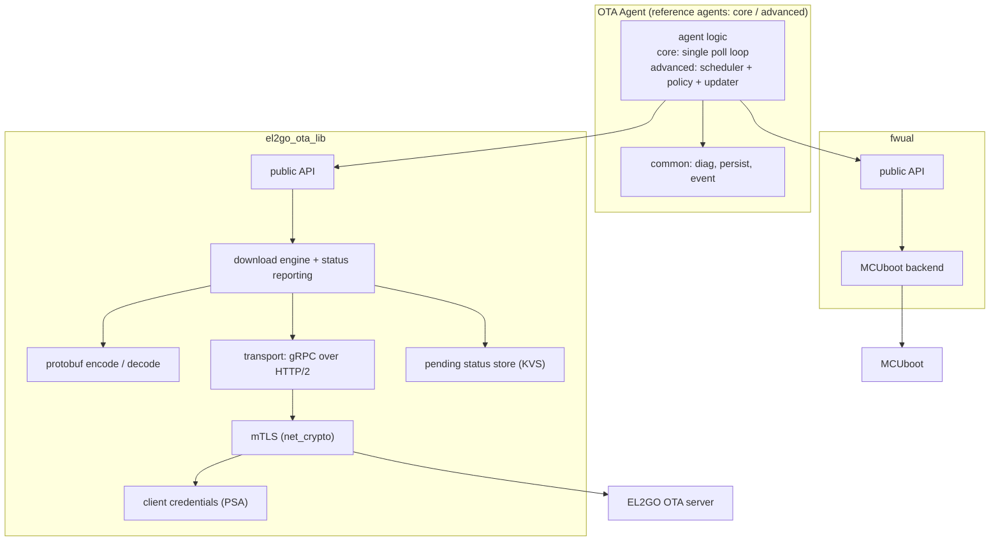
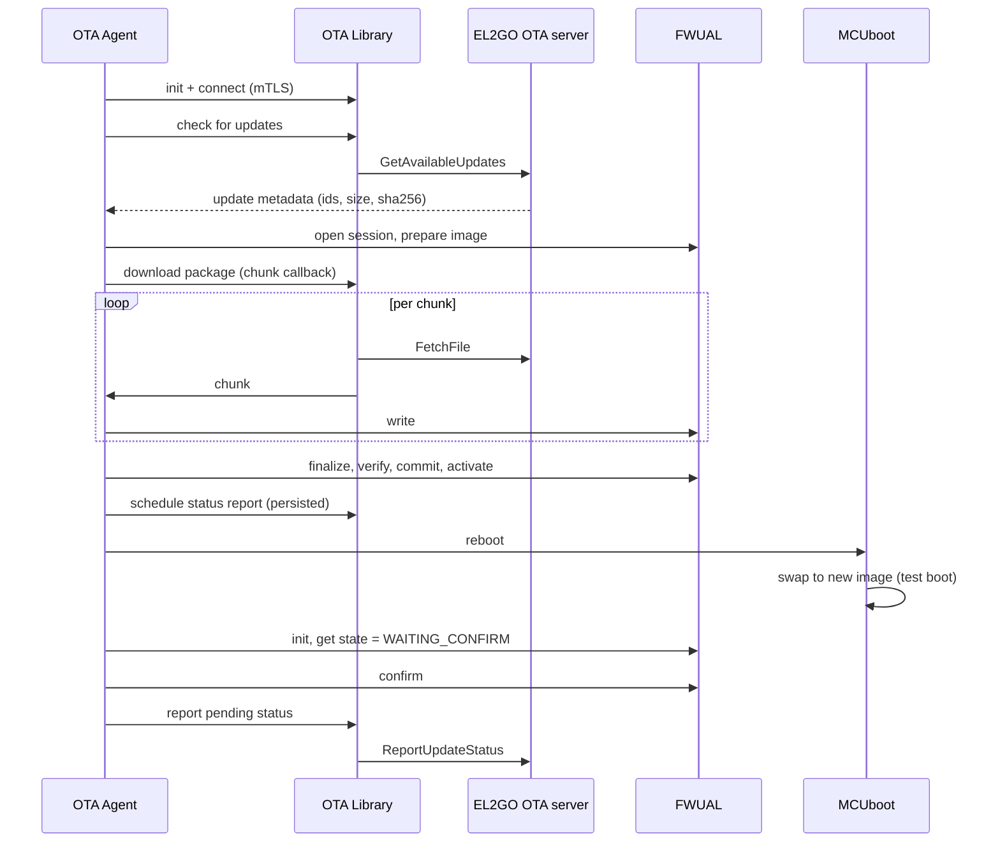
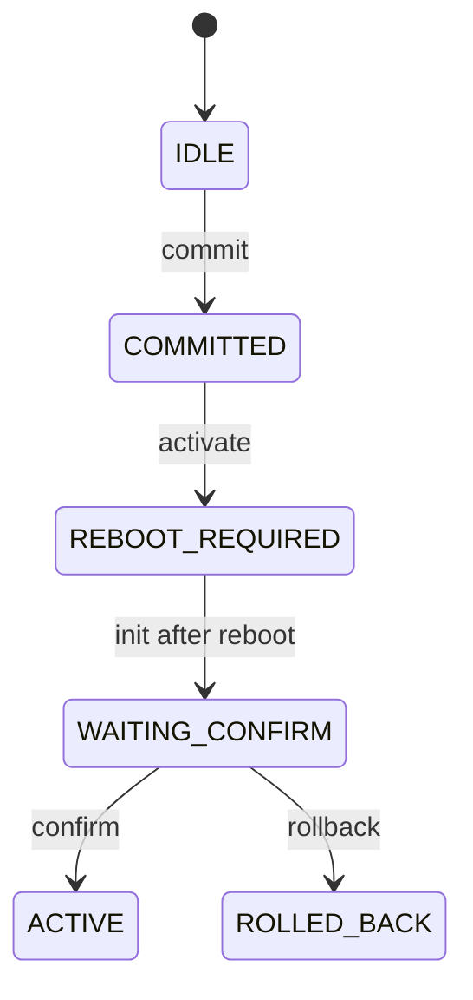
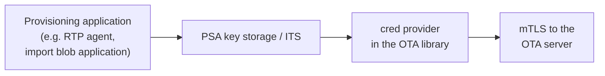

# EL2GO OTA Libraries Guide

High-level overview of the OTA-related components in this repository:

- **EL2GO OTA Library** -- `libs/el2go_ota_lib`
- **Firmware Update Abstraction Layer (FWUAL)** -- `libs/fwual`
- **Reference OTA agents** -- `applications/ota_agents`

This guide explains how the components fit together and where to look for details.

---

## Table of Contents

1. [Components and Responsibilities](#components-and-responsibilities)
2. [Directory Layout](#directory-layout)
3. [Architecture](#architecture)
4. [Update Flow](#update-flow)
5. [EL2GO OTA Library](#el2go-ota-library)
6. [FWUAL](#fwual)
7. [Credentials and Secure Storage](#credentials-and-secure-storage)
8. [Reference Agents](#reference-agents)
9. [Build Integration](#build-integration)
10. [Pluggable Backends](#pluggable-backends)
11. [Testing](#testing)
12. [Known Limitations](#known-limitations)
13. [Where to Find Details](#where-to-find-details)

---

## Components and Responsibilities

| Component | Responsibility | Not responsible for |
|-----------|----------------|---------------------|
| EL2GO OTA Library | mTLS connection to the EL2GO OTA server, update check, chunked download, status reporting | Writing flash, update policy, image verification |
| FWUAL | Writing images, hash verification, staging, activation, confirmation and rollback via the bootloader | Networking, policy, retries |
| OTA Agent | Orchestration: when to check, policy, passing downloaded data to FWUAL, reboot, post-boot handling | Integrity/authenticity checks, flash or slot management |
| Bootloader (MCUboot) | Secure boot, image swap and revert | -- |

The OTA Agent role is implemented by two reference agents: the **core** agent (minimal, readable flow) and the
**advanced** agent (production-style: scheduling with backoff, blackout and defer policy, retries, persisted agent
state). They are compared in [Reference Agents](#reference-agents).

The device always initiates communication (client-driven OTA); the server never pushes commands.

---

## Directory Layout

```text
.
├── include/
│   ├── ota/                  Public OTA Library headers (API, mTLS config, default root CA)
│   └── fwual/                Public FWUAL headers (API, states, result codes)
├── libs/
│   ├── el2go_ota_lib/        OTA Library: public facade (el2go_ota_lib.c) and internal modules in src/
│   ├── fwual/                FWUAL weak defaults (fwual.c) and backends (mcuboot/)
│   └── protobuf/ota/         Generated nanopb code for the OTA protocol
├── doc/protobuf/ota/         OTA protocol .proto definitions
├── applications/ota_agents/
│   ├── el2go_ota_agent_core/       Minimal reference agent
│   ├── el2go_ota_agent_advanced/   Production-style reference agent
│   └── common/                     Agent support modules: diagnostics, persistence, events
├── zephyr/
│   ├── samples/el2go_ota_agent_*/  Zephyr sample wrappers (configuration, overlays, sysbuild)
│   └── tests/el2go_{fwual,ota,ota_agent}_*   Zephyr test apps
└── tests/                    Unit and component tests
```

---

## Architecture



The OTA Library and FWUAL are independent of each other: neither one calls or depends on the other. The OTA agent
is the glue between them. It uses the OTA Library to talk to the server and download the update, and passes the
downloaded data to FWUAL to be written, verified and activated.

---

## Update Flow



If the new image is not confirmed, MCUboot reverts to the previous image on the next reset. The advanced agent
detects this after the reboot (from the FWUAL state or from the persisted expected version) and reports a rollback
(see [Reference Agents](#reference-agents)).

---

## EL2GO OTA Library

- **Protocol:** gRPC over a minimal built-in HTTP/2 client, over mTLS (ALPN `h2`). The service is
  `OtaUpdateDeliveryService` in `doc/protobuf/ota/ota-delivery.proto`; the `.proto` file is authoritative.
- **Authentication:** mTLS is always used. The server certificate is verified against the CA chain passed in
  `el2go_ota_mtls_config_t`. The client certificate is read from the secure storage and the private key is used by
  its key ID; the key never leaves the secure storage.
- **Download:** chunked (`EL2GO_OTA_CHUNK_SIZE`), with a resume offset and a small internal retry on network errors.
  Each chunk is handed to the agent through a callback; the library does not buffer the image.
- **Status reporting:** a report is persisted in a key-value store before it is sent and deleted only after the
  server acknowledges it. This lets the agent schedule a report before rebooting and deliver it after the new
  image has started.

Internal modules in `libs/el2go_ota_lib/src/`:

| Module | Path |
|--------|------|
| mTLS setup | `el2go_ota_tls.c` |
| Request encoding / response decoding | `el2go_ota_request_builder.c`, `el2go_ota_response_handler.c` |
| Update check and chunked download | `download/` |
| Status reporting | `el2go_ota_status_reporting.c` |
| Transport interface and gRPC backend | `transport/` |
| Client credential provider | `cred/` |
| Key-value store for the pending status | `osal/` |

---

## FWUAL

FWUAL is an OS-independent firmware update API. The agent drives it through a fixed lifecycle:

```
open session -> prepare -> write ... -> finalize -> verify -> commit -> activate -> close session
(reboot)
init -> WAITING_CONFIRM -> confirm   (or rollback)
```



- `libs/fwual/fwual.c` contains weak defaults; a backend provides the real implementation.
- The only backend today is **MCUboot** (`libs/fwual/mcuboot/`, Zephyr). It writes to the MCUboot secondary slot,
  verifies SHA-256, requests a test swap on activate and confirms the image after reboot.
- The upgrade is requested in MCUboot test mode (`BOOT_UPGRADE_TEST` in `fwual_activate()`, see
  `libs/fwual/mcuboot/fwual_mcuboot.c`), so the swap is temporary until the agent calls `fwual_confirm()`.
- FWUAL state is persisted in NVS so that the state survives the reboot and power loss.
- FWUAL never reboots the device; the agent does.

The call order, return codes and capability flags are documented in `include/fwual/fwual.h`.

The OTA samples require MCUboot to be configured for swap using the "move" variant; the details are in the
sample READMEs (see [Reference Agents](#reference-agents)).

---

## Credentials and Secure Storage

The OTA Library never creates credentials. The mTLS client key and certificate are provisioned beforehand and
only read by the OTA Library.



Which partition holds the credentials, which files configure it and which rules apply (for example, not erasing
the partition between the provisioning application and the OTA agent) are described in the "Credentials and secure
storage (PSA ITS)" section of the
[OTA agent core sample README](../../zephyr/samples/el2go_ota_agent_core/README.rst).

The provisioning side is described in two places:

- The RTP agent: [the RTP library guide](../rtp/el2go_rtp_lib.md).
- The import blob application: [Import blob application](../../applications/el2go_import_blob/README.md).

---

## Reference Agents

| Aspect | `el2go_ota_agent_core` | `el2go_ota_agent_advanced` |
|--------|------------------------|----------------------------|
| Purpose | Minimal, readable reference flow | Production-style reference |
| Scheduling | Fixed poll loop | Scheduler with backoff and immediate check on network up |
| Policy | None | Blackout and defer windows (needs SNTP time) |
| Retries | Status report after reboot | Download and status report |
| Persisted agent state | None | Yes, used to reconcile interrupted or rejected updates after reboot |
| Diagnostics | Console | Console + persistent flash log |

Both agents run their logic in a single thread. The advanced agent is split into `scheduler.c`, `policy.c` and
`updater.c`; the boot reconciliation logic is in `updater_finalize_boot()`.

Configuration, flash layout and how to run the agents are described in the sample READMEs. The application guides
describe what each agent does:

- [OTA agent core application](../../applications/ota_agents/el2go_ota_agent_core/README.md)
- [OTA agent advanced application](../../applications/ota_agents/el2go_ota_agent_advanced/README.md)

---

## Build Integration

The OTA components are opt-in in both build systems.

| Build | How OTA is enabled | Notes |
|-------|--------------------|-------|
| Zephyr (module) | `CONFIG_EL2GO_OTA_LIBRARY_SOURCES=y`, `CONFIG_EL2GO_OTA_FWUAL_LIBRARY_SOURCES=y`, `CONFIG_EL2GO_OTA_PLATFORM_SOURCES=y`, plus the agent support options (`CONFIG_EL2GO_OTA_DIAG_SOURCES`, `_PERSIST_SOURCES`, `_EVENT_SOURCES`, `CONFIG_EL2GO_NETWORK_SOURCES`, `CONFIG_EL2GO_SYSTEM_SOURCES`, `CONFIG_EL2GO_TIME_SOURCES`) | Wired in `zephyr/CMakeLists.txt`. The sample `prj.conf` files are the reference configuration. |
| CMake (Linux / standalone) | `-DBUILD_OTA=ON` | Builds `fwual`, `el2go_ota_lib` and the agents. The API manual is available as [EL2GO_OTA_UserManual.pdf](EL2GO_OTA_UserManual.pdf). |

---

## Pluggable Backends

Like the RTP library, the OTA components use pluggable backends: each one is
selected at configure time and compiled in statically; there is no runtime
selection. New backends can be added without changing the public API.

### How selection works

- **Zephyr:** Kconfig `choice` symbols are translated into CMake variables in `zephyr/CMakeLists.txt`
  (e.g. `CONFIG_EL2GO_OTA_DIAG_BACKEND_RINGBUF` -> `DIAG_BACKEND=ringbuf`).
- **CMake (non-Zephyr):** the same variables are set directly as cache variables or `-D` options.
- The variable names a **subdirectory** next to the interface header (`<interface dir>/<value>/` or
  `<interface dir>/${OS}/<value>/`), which is added to the build.
- Most interfaces also have a `__weak` default implementation, so the build links even without a backend.
  The credential provider has no default; a provider must always be selected.

Two behaviours exist when the selected backend directory is missing:

| Where | Missing backend directory |
|-------|---------------------------|
| OTA Library (`cred`, `transport`, `osal`) | CMake `FATAL_ERROR` at configure time |
| Agent support (`diag`, `persist`, `event`) and app common (`network`, `system`, `time`) | Silently skipped; the weak default is used |

### Backends shared with the RTP library

These are build-wide and also select what the OTA Library links against.

| Variable | Default (Zephyr) | Default (Linux) | Selects |
|----------|------------------|-----------------|---------|
| `OS` | `zephyr` | `linux` | OSAL (`libs/osal/${OS}`), OTA KVS backend, agent support backends |
| `PLATFORM` | `els_pkc` (set in `zephyr/CMakeLists.txt`) | `smw` | `libs/platforms/${PLATFORM}`: PSA crypto init, cipher suites/curves used by the OTA TLS connection |
| `CRYPTO_BACKEND` | `mbedtls` | `mbedtls` | `libs/net_crypto/${CRYPTO_BACKEND}`: TLS implementation used for mTLS |

### OTA-specific backends

| Backend | Zephyr Kconfig | CMake variable | Default | Available | Interface |
|---------|----------------|----------------|---------|-----------|-----------|
| Client credential provider | `EL2GO_OTA_CRED_PROVIDER` choice | `EL2GO_OTA_CRED_PROVIDER` | `psa` | `psa` | `libs/el2go_ota_lib/src/cred/el2go_ota_cred.h` |
| Message transport | `EL2GO_OTA_TRANSPORT_BACKEND` choice | `EL2GO_OTA_TRANSPORT_BACKEND` | `grpc` | `grpc` | `libs/el2go_ota_lib/src/transport/el2go_ota_transport.h` |
| Pending status store (KVS) | follows `OS` | follows `OS` | -- | `zephyr` (NVS); `linux` uses the weak default (no persistence) | `libs/el2go_ota_lib/src/osal/el2go_ota_kvs.h` |
| FWUAL backend | always `mcuboot` on Zephyr | none (weak defaults only) | -- | `mcuboot` | `include/fwual/fwual.h` |
| Agent diagnostics | `EL2GO_OTA_DIAG_BACKEND` choice | `DIAG_BACKEND` | `console` | `console`, `ringbuf` | `applications/ota_agents/common/diag/el2go_ota_diag.h` |
| Agent state persistence | `EL2GO_OTA_PERSIST_BACKEND` choice | `PERSIST_BACKEND` | `default` (RAM only) | `nvs` | `applications/ota_agents/common/persist/el2go_ota_persist.h` |
| Network-up event | `EL2GO_OTA_EVENT_BACKEND` choice | `EVENT_BACKEND` | `default` (no events) | `netmgmt` | `applications/ota_agents/common/event/el2go_ota_event.h` |
| Network | `EL2GO_NETWORK_BACKEND` choice | `NET_BACKEND` | `wifi` if `CONFIG_WIFI` | `wifi` | `applications/common/network/el2go_app_net.h` |
| Time | `EL2GO_TIME_BACKEND` choice | `TIME_BACKEND` | `default` (time unknown) | `sntp` | `applications/common/time/el2go_app_time.h` |
| System (reboot, sleep, uptime) | -- | `SYSTEM_BACKEND` | `default` | `default` | `applications/common/system/el2go_app_sys.h` |

On Linux none of the agent support or FWUAL backends exist yet, so the weak defaults are linked
(see [Known Limitations](#known-limitations)).

### Adding a backend

1. Create a subdirectory named after the backend next to the interface (or under `${OS}/` for
   OS-specific modules) with a `CMakeLists.txt` that adds the sources to the existing target
   using the helpers in `cmake/add_target_sources.cmake`.
2. Implement all functions of the interface header as strong symbols; they override the `__weak` defaults.
3. For Zephyr, add an entry to the matching Kconfig `choice` (`libs/el2go_ota_lib/Kconfig` or `zephyr/Kconfig`)
   and map it to the CMake variable in `zephyr/CMakeLists.txt` if it is not mapped already.
4. Run the public and internal test suites of the affected component.

The FWUAL backend is the exception: it is currently added unconditionally (`libs/fwual/CMakeLists.txt`,
`add_subdirectory(mcuboot)`). A second FWUAL backend needs a selection variable there first.

To port to a new platform, start with the FWUAL backend and the KVS; the remaining backends are
mostly reusable or have usable weak defaults.

---

## Testing

- Test sources: `tests/unit/` and `tests/component/`, split into `public_*` (public API only) and `internal_*`
  suites for `fwual`, `ota_lib`, `ota_agent_core` and `ota_agent_advanced`.
- Zephyr test apps: `zephyr/tests/el2go_fwual_*`, `el2go_ota_*`, `el2go_ota_agent_*` (mostly `native_sim`,
  some also on RW612 boards).
- On Linux, the same suites are built with `BUILD_OTA=ON BUILD_TESTING=ON` (registered in CTest, disabled by default).

---

## Known Limitations

- Zephyr only in practice. On Linux the code builds, but there is no FWUAL backend and no persistent
  key-value store.
- One update session at a time; the OTA Library and FWUAL are not thread-safe.
- Full images only (no delta); SHA-256 only.
- The default root CA in `include/ota/el2go_ota_certificates.h` is a placeholder and must be replaced.

---

## Where to Find Details

| Topic | Source |
|-------|--------|
| Public API (functions, types, return codes) | [API manual (PDF)](EL2GO_OTA_UserManual.pdf), headers in `include/ota/`, `include/fwual/` |
| Protocol messages | `doc/protobuf/ota/ota-delivery.proto` |
| Configuration, flash layout, build and run | [OTA agent core sample](../../zephyr/samples/el2go_ota_agent_core/README.rst), [OTA agent advanced sample](../../zephyr/samples/el2go_ota_agent_advanced/README.rst) |
| Kconfig options | `libs/el2go_ota_lib/Kconfig`, `libs/fwual/mcuboot/Kconfig`, `zephyr/Kconfig` |
| Backend selection (Zephyr) | `zephyr/CMakeLists.txt` |
