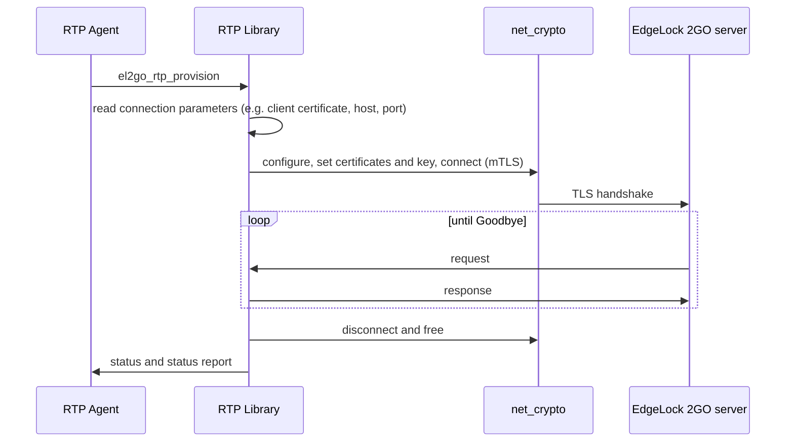

# EL2GO RTP Library Guide

This document gives a high-level overview of the Remote Trust Provisioning (RTP) library located in
`libs/el2go_rtp_lib`. It describes the components the library relies on, explains how they fit together, and indicates
where further details can be found.

---

## Table of Contents

1. [Components and Responsibilities](#components-and-responsibilities)
2. [Directory Layout](#directory-layout)
3. [Architecture](#architecture)
4. [Provisioning Flow](#provisioning-flow)
5. [Dispatcher and Endpoints](#dispatcher-and-endpoints)
6. [Build Integration](#build-integration)
7. [Pluggable Backends](#pluggable-backends)
8. [Testing](#testing)
9. [Known Limitations](#known-limitations)
10. [Where to Find Details](#where-to-find-details)

---

## Components and Responsibilities

| Component | Responsibility |
|-----------|----------------|
| RTP Library | mTLS connection to the EdgeLock 2GO server, handling of the server requests, status report |
| Keystore | Provisioned objects and the claim code; provides the client certificate and key id |
| Datastore | Server connection configuration (e.g. host, port) |
| Platform | Secure hardware access, device UUID, TLS cipher suites and curves |
| net_crypto | TLS client used for the mTLS connection |

The RTP Agent is not a component of the library. It is the application that uses the library and orchestrates the
provisioning: registration mode, when to provision and cleanup. See the
[RTP agent application](../../applications/el2go_rtp_agent/README.md).

The device always initiates the connection. After the TLS handshake the server sends requests and the library
answers them.

---

## Directory Layout

```text
.
├── include/
│   ├── rtp/                  Public RTP headers (el2go_rtp.h, el2go_rtp_config.h, el2go_rtp_certificates.h,
│   │                         el2go_rtp_claimcode.h, el2go_rtp_timing.h)
│   └── common/               Public headers for keystore, datastore, platform, status codes and version
├── libs/
│   ├── el2go_rtp_lib/        The library: el2go_rtp.c, el2go_rtp_dispatcher.c, el2go_agent_endpoint.c,
│   │                         el2go_rtp_status_report.c, el2go_rtp_timing.c
│   ├── keystores/            Keystore interface and backends (see Pluggable Backends)
│   ├── datastores/           Datastore interface and implementations (see Pluggable Backends)
│   ├── platforms/            Platform interface and backends (see Pluggable Backends)
│   ├── net_crypto/           TLS abstraction with the mbedtls backend
│   ├── common/               Default server CA certificates, connection configuration parsing and
│   │                         validation, datastore connection helpers
│   ├── protobuf/             Generated nanopb code
│   └── osal/                 OS abstraction (zephyr, linux)
├── doc/protobuf/RTP/         .proto message definitions
├── applications/
│   └── el2go_rtp_agent/      Reference RTP agent
└── zephyr/samples/
    └── el2go_rtp_agent/      Zephyr sample (configuration, overlays, Kconfig)
```

The interfaces and backends in `libs/keystores/`, `libs/datastores/` and `libs/platforms/` are described in
[Pluggable Backends](#pluggable-backends).

---

## Architecture

The RTP library is the central component. The platform, keystore, datastore, OS abstraction, protobuf, net_crypto and
common components are all linked together into it, so that together they form the complete RTP library.

The library does not create the platform, keystore or datastore itself. The user application (for example the
reference RTP agent) is responsible for:

1. Creating and initializing the platform, the keystore and the datastore.
2. Registering the keystore and the datastore with the RTP library (`el2go_rtp_add_keystore` and
   `el2go_rtp_add_datastore`).

Once registered, the library uses the keystore and the datastore during provisioning and exposes them as endpoints
to the server.

---

## Provisioning Flow

The flow of `el2go_rtp_provision()` in `libs/el2go_rtp_lib/el2go_rtp.c`:



- The server connection parameters are read from the datastore. If the datastore is not set or fails validation,
  the library uses the compile-time defaults from `include/rtp/el2go_rtp_config.h`.
- The client certificate is taken from the keystore; if none is available, a self-signed one is generated.
- A status report is returned through the optional out-parameter of `el2go_rtp_provision()`. It is printed with
  `el2go_rtp_print_status_report()` and released with `el2go_rtp_free_status_report()`.
- If the exchange completes but some objects fail, the function returns `EL2GO_STATUS_RTP_PROVISIONING_FAILED` and
  the report describes the outcome.
- Objects provisioned by RTP end up in secure storage. The keystore is responsible for storing them; for a
  keystore of type `psa`, this is done through the PSA functions.

Recommended call order: `el2go_rtp_init`, `el2go_rtp_add_keystore`, `el2go_rtp_add_datastore`,
`el2go_rtp_datastore_el2go`, `el2go_rtp_provision`, print and free the report, `el2go_rtp_remove_datastore`,
`el2go_rtp_remove_keystore`, `el2go_rtp_free`. The signatures are in `include/rtp/el2go_rtp.h`.

---

## Dispatcher and Endpoints

The dispatcher (`libs/el2go_rtp_lib/el2go_rtp_dispatcher.c`) is the component responsible for handling the server
messages. The messages are received from the server and dispatched either to the library itself (for example
`AgentHelloRequest`) or to the endpoint they are addressed to (a registered keystore or datastore).

| Message | Behavior |
|---------|----------|
| `AgentHelloRequest` | The library answers with its endpoint list: the agent endpoint, then the registered keystores, then the registered datastores |
| Endpoint requests | Routed to the endpoint selected by (endpoint type, endpoint id); an unknown endpoint ends with `EL2GO_STATUS_RTP_ENDPOINT_NOT_FOUND` |
| Responses | Accumulated and written to the connection once per received message batch |
| Goodbye and CRL | Handled by the agent endpoint (`el2go_agent_endpoint.c`); Goodbye ends the dispatch loop |

Note: with `EL2GO_RTP_REQUEST_CRL` set to 1 (default), the dispatcher accepts only Hello, Goodbye and CRL messages
until the CRL is verified. Any other message ends with `EL2GO_STATUS_RTP_CRL_NOT_VERIFIED`.

The message definitions are the `.proto` files in `doc/protobuf/RTP/`; they are authoritative.

---

## Build Integration

| Build | How RTP is enabled | Notes |
|-------|--------------------|-------|
| Zephyr (module) | `CONFIG_EL2GO_RTP_AGENT=y` | Built with `zephyr_library_named(el2go_rtp)` and wired in `zephyr/CMakeLists.txt`. The `EL2GO_RTP_*` Kconfig symbols are defined in `zephyr/samples/el2go_rtp_agent/Kconfig`. |
| CMake (Linux) | Default Linux build | Produces `libel2go_rtp.so` and an installed CMake package. See [the Linux build guide](rtp_linux_build_instructions.md). |

The API manual is available as [EL2GO_RTP_UserManual.pdf](EL2GO_RTP_UserManual.pdf).

---

## Pluggable Backends

The library is designed around pluggable backends: the platform, crypto (TLS), keystore and OS abstraction are
interfaces with interchangeable implementations. This allows the same RTP library to run on different hardware,
operating systems and storage solutions, by selecting the matching backend.

Backends are selected at configure time through CMake variables and compiled in statically. The RTP-relevant
variables and the values available in the tree are:

| Variable | Values in the tree |
|----------|--------------------|
| `PLATFORM` | `els_pkc` (Zephyr default), `smw` (Linux default) |
| `CRYPTO_BACKEND` | `mbedtls` |
| `KEYSTORE` | `psa` |
| `OS` | `zephyr`, `linux` |

Notes:

- The `els_pkc` platform comes in two flavors, `psa/` and `tfm/` (sub-directories of the platform), selected with
  `CONFIG_EL2GO_RTP_PSA_BACKEND_TFM`.
- The datastore is the exception: it is not selected through CMake. The `plain` and `fs` implementations are both
  compiled in, because both can be implemented on the same system (for example on Linux, where a file system is
  available). The one to use is therefore chosen at runtime when calling `el2go_datastore_init`. The reference agent
  uses the `plain` datastore implementation.

The CMake options for the Linux build are also described in the
[Pluggable Backends section of the Linux build guide](rtp_linux_build_instructions.md#pluggable-backends).

---

## Testing

- The RTP library is covered by unit tests: `tests/unit/public_rtp` (testing the public API) and
  `tests/unit/internal_rtp` (testing the internal functions). The datastore, keystore, net_crypto and platform
  components have their own unit test suites in `tests/unit`.
- On Linux, the tests are built as `el2go_unit_tests_public` and `el2go_unit_tests_internal` when `BUILD_TESTING=ON`
  is set. See the [Testing section of the Linux build guide](rtp_linux_build_instructions.md#testing) for details.
- No test application exists for the RTP library on Zephyr.

---

## Known Limitations

- One keystore and one datastore can be registered (`EL2GO_RTP_MAX_KEYSTORES` and `EL2GO_RTP_MAX_DATASTORES` in
  `include/rtp/el2go_rtp_config.h`).
- The default host name in `include/rtp/el2go_rtp_config.h` is a placeholder and must be replaced. The default port
  is 443.
- On Zephyr builds without TF-M, the secure storage has no runtime isolation; see the note in
  the [RTP agent sample README](../../zephyr/samples/el2go_rtp_agent/README.rst).

---

## Where to Find Details

| Topic | Source |
|-------|--------|
| Public API (functions, types, return codes) | [API manual (PDF)](EL2GO_RTP_UserManual.pdf), headers in `include/rtp/` and `include/common/` |
| Protocol messages | [`doc/protobuf/RTP/`](../protobuf/RTP/) |
| Zephyr configuration, build and run | [RTP agent sample](../../zephyr/samples/el2go_rtp_agent/README.rst) |
| Reference agent details | [RTP agent application](../../applications/el2go_rtp_agent/README.md) |
| Linux build, install and tests | [Linux build instructions](rtp_linux_build_instructions.md) |
